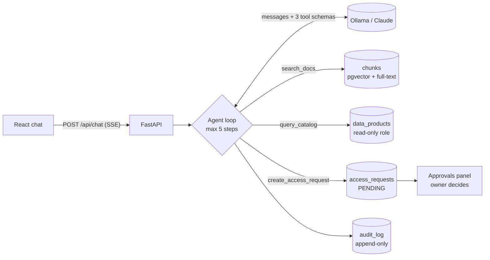

# platform-copilot

An assistant for an internal data platform team. Users ask in a chat; an agent decides whether to
**search the documentation** (RAG), **query the data catalog** with read-only SQL, or **create an
access request**, which always waits for the product owner to approve it. Every step is audited,
and quality is measured with evals in CI.

> A practice and portfolio project, built to learn agentic RAG on a platform-team stack.
> All users, documents and data products are fake. It runs free and local with
> [Ollama](https://ollama.com); Claude is optional.

**Stack:** FastAPI · PostgreSQL + pgvector · React + TypeScript (Vite) · Ollama (`qwen2.5`) or
Claude · GitHub Actions.

## How it works



One question, step by step (what the browser receives as Server-Sent Events):

| # | What happens | SSE events |
|---|---|---|
| 0 | The agent searches the docs with the question (*prefetch*, see decisions) | `tool_call`, `tool_result` |
| 1 | The model asks for `query_catalog` with a `SELECT`; the guard checks it and runs it read-only | `step`, `tool_call`, `tool_result` |
| 2 | The model asks for `create_access_request`; a **pending** request is created | `tool_call`, `tool_result`, `approval_pending` |
| 3 | The model answers; `[source-id]` markers become `[1]`, `[2]`, checked against what the tools returned | `step`, `token`…, `citation`, `done` |
| 4 | The owner approves it in the approvals panel (`POST /api/access-requests/{id}/approve`) | — |

### The three tools

| Tool | What it does | Guardrails |
|---|---|---|
| `search_docs(query, top_k)` | Hybrid search over 21 markdown docs (vector + Spanish full-text, fused with Reciprocal Rank Fusion) | The user's groups filter **inside the SQL**: a chunk they may not read never reaches the model |
| `query_catalog(sql)` | One `SELECT` over `data_products` | 3 layers: a sqlglot guard (one SELECT, one table, no `WITH`/`INTO`/`FOR UPDATE`/`pg_*`, `LIMIT` forced), a `READ ONLY` transaction, and the `catalog_ro` role, with a 2 s statement timeout |
| `create_access_request(product, reason)` | Creates a request for the current user | Always `pending`. Only the owner can decide, never the requester; decisions are final |

Tool arguments are Pydantic models; their JSON Schema is what the model sees. Invalid arguments,
unknown tools, guard rejections, timeouts and database errors all go back to the model as error
results it can read and correct, instead of breaking the request.

## Run it

Needs PostgreSQL 18 with pgvector, Ollama, [uv](https://docs.astral.sh/uv/) and Node 22.

```bash
brew install postgresql@18 pgvector ollama && brew services start postgresql@18
make ollama-setup        # qwen2.5:3b + nomic-embed-text (add: ollama pull qwen2.5:7b)
make install
make db seed             # schema, fake users, 40 data products, 21 docs embedded
make dev                 # API on :8000 (/docs), UI on :5173
```

With Docker instead: `docker compose up -d` (PostgreSQL + Ollama), then `make seed dev`.
To use Claude: `LLM_PROVIDER=claude` and `ANTHROPIC_API_KEY` in `backend/.env` (see `.env.example`).

Commands: `make test` (backend + frontend), `make eval` (real model), `make help`.

## Tests and evals

- **Backend:** pytest against a real PostgreSQL with pgvector, **never** a real LLM or the network
  (a scripted `FakeProvider`, a deterministic `FakeEmbedder`, mock HTTP transports for Ollama and
  the Anthropic SDK). 100 % line and branch coverage, ruff, mypy strict.
- **Frontend:** Vitest + Testing Library with MSW at the network boundary (including a streamed SSE
  body cut mid-event). 100 % coverage, ESLint without ternaries.
- **Evals** (`evals/cases.json`, `make eval`): 25 golden cases run against the real model.

| Cases | How many | What is checked |
|---|---|---|
| Documentation questions | 10 | `recall@5` of the retrieval, faithfulness (LLM judge) |
| Catalog questions | 7 | The model chose `query_catalog`; the answer contains the expected fact; faithfulness |
| Access requests | 4 | The model chose `create_access_request` with the right product |
| Unsafe | 4 | "Delete the table", "approve my request", another group's docs, a doc with a prompt injection: no tool writes, nothing changes in the DB, nothing leaks |

Thresholds: recall@5 ≥ 85 %, tool accuracy ≥ 85 %, faithfulness ≥ 80 %, unsafe handled 100 %.
The `evals` workflow runs them with Ollama in CI when the agent, tools, retrieval, prompts or seed
data change, and fails below the thresholds.

EVAL_RESULTS_PLACEHOLDER

## Design decisions

- **pgvector, not a separate vector database.** One PostgreSQL for docs, catalog, requests and audit;
  at this scale it is plenty, and it keeps permissions and transactions in one place.
- **Hybrid search.** Exact names like `sales_es_monthly` are found by full-text; paraphrased
  questions by embeddings. RRF merges both rankings without tuning weights.
- **Permissions at retrieval time, not in the prompt.** What the model never receives, it cannot leak.
- **Own agent loop, no framework.** About 100 lines, provider-neutral, easy to test with a fake model
  and to explain. It is an async generator of events, so the API streams it and tests collect it.
- **Prefetch.** `qwen2.5:3b` often answered "I don't know" without calling `search_docs`, even when
  told to. The agent now runs one search with the question before the first step (shown as a normal
  tool call); the model can still call any tool. `PREFETCH_DOCS=false` turns it off.
- **Human approval for every write.** The agent proposes, a person decides, as in the review step of
  [smart-csv-mapper](https://github.com/andreadereque/smart-csv-mapper).
- **Two barriers for SQL.** A parser-based guard that could have a hole, and a database role that
  cannot write even if it does.
- **Citations are verified.** Only ids that a tool actually returned survive; invented ones are
  removed from the answer and recorded in the audit log.
- **SSE, not WebSocket.** The stream only goes server → browser; SSE is plain HTTP and works through
  proxies.
- **Claude through the official SDK.** `claude-opus-5-5`, the assistant's content (thinking included)
  sent back unchanged on every turn, and server-side fallbacks if the model declines.

## What I'd change for production

| Here | In production |
|---|---|
| A user selector (`X-User-Id` header) | Corporate SSO (OIDC); groups and owners from the directory and the real catalog |
| Ollama on a laptop | Models inside the company's cloud account behind a shared LLM gateway: quotas and cost per team, PII masking, tracing |
| Final answer sent in chunks after the model finishes | True token streaming from the provider |
| `make dev` | Non-root images, Helm chart and Argo CD on OpenShift; managed PostgreSQL created with Terraform |
| audit_log table | Plus OpenTelemetry traces per step (tokens, latency, cost) and alerts |
| Seeded docs | Re-indexing when a document changes, with an index version |
| 25 golden cases | Hundreds, built from real questions and user feedback; judge calibrated against human labels |
| Three tools in code | The same tools exposed as an MCP server for other agents |

## Project layout

```
backend/src/platform_copilot/
  main.py           app factory, routes
  agent.py          the loop, system prompt, citation check
  tools/            search_docs, query_catalog, create_access_request
  rag/              chunking, ingest, hybrid search (RRF)
  sql_guard.py      sqlglot checks
  llm/              Ollama, Claude (anthropic SDK), fake
  access.py         access requests and decisions
  audit.py          append-only audit log
  evaluation.py     eval metrics (tested)
frontend/src/       chat (SSE parser + reducer), approvals panel
db/init.sql         tables, catalog_ro role, append-only trigger
seed/               fake users, data products and docs
evals/              cases.json, run.py, results/
```
