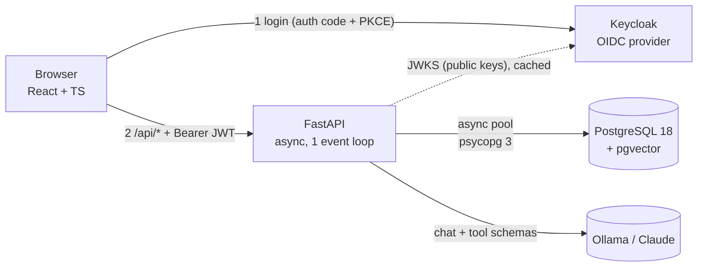
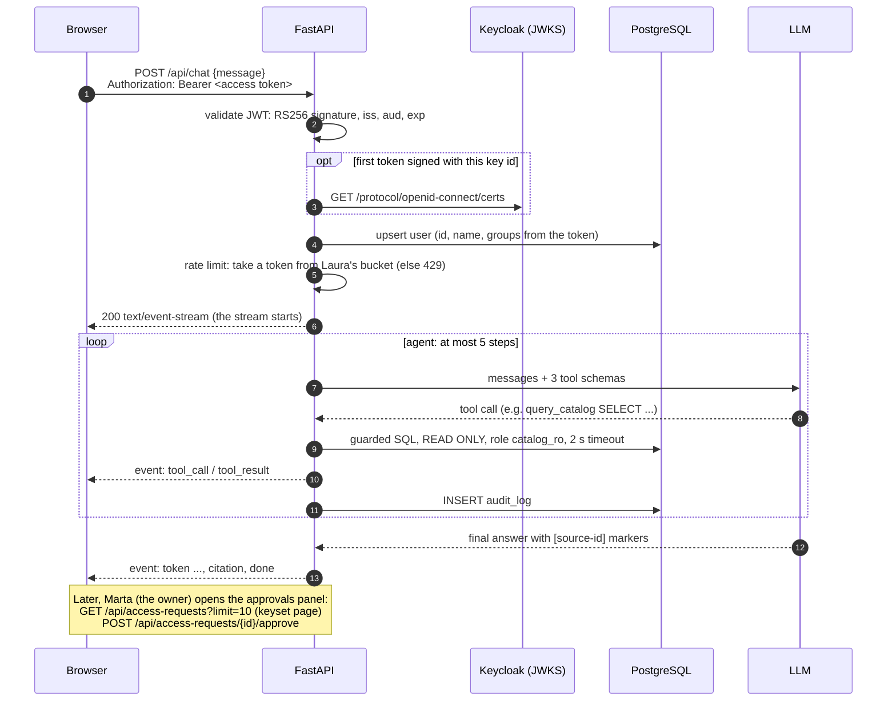
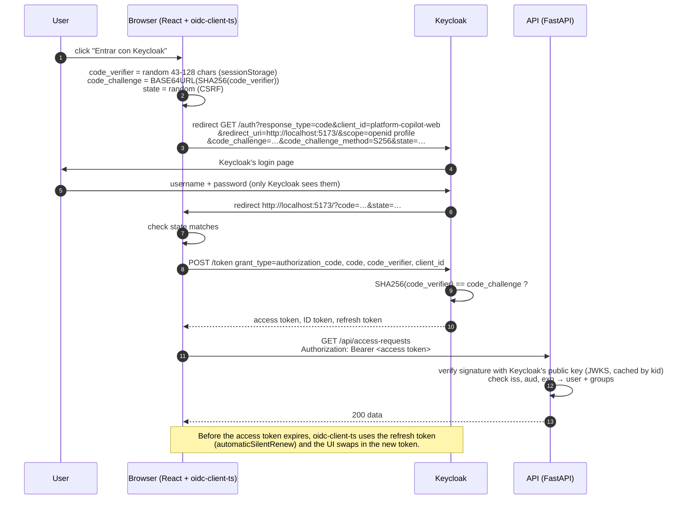

# Architecture

How platform-copilot works end to end, written to be explained in an interview: what each piece
does, why it is built that way, and what would change at a bigger scale. Every section points to
the code that implements it.

- [1. The system in one minute](#1-the-system-in-one-minute)
- [2. One request, end to end](#2-one-request-end-to-end)
- [3. Login: OAuth 2.0 authorization code + PKCE (OIDC)](#3-login-oauth-20-authorization-code--pkce-oidc)
- [4. Pagination: keyset, not offset](#4-pagination-keyset-not-offset)
- [5. Concurrency vs parallelism](#5-concurrency-vs-parallelism)
- [6. The async database driver](#6-the-async-database-driver)
- [7. Rate limiting](#7-rate-limiting)
- [8. How it is tested (pytest)](#8-how-it-is-tested-pytest)
- [9. How it would scale](#9-how-it-would-scale)
- [10. Quick answers](#10-quick-answers)
- Part 2, AI engineering in production:
  [11. Two agent engines: own loop and LangGraph](#11-two-agent-engines-own-loop-and-langgraph) ·
  [12. Context engineering](#12-context-engineering) ·
  [13. Observability: traces, latency, cost](#13-observability-traces-latency-cost) ·
  [14. Evaluation and the production feedback loop](#14-evaluation-and-the-production-feedback-loop) ·
  [15. Monitoring and drift](#15-monitoring-and-drift) ·
  [16. Safety nets and security](#16-safety-nets-and-security) ·
  [17. Deploying on GCP](#17-deploying-on-gcp)

## 1. The system in one minute

A chat assistant for an internal data platform. A user logs in, asks a question, and an agent
(an LLM in a loop with three tools) searches the docs, queries the data catalog read-only, or
creates an access request that only the product's owner can approve. Every step is streamed to
the browser and written to an append-only audit log.



| Layer | Technology | Where |
|---|---|---|
| UI | React 19, TypeScript, TanStack Query, oidc-client-ts, zod | `frontend/src/` |
| Identity | Keycloak (OIDC), realm generated from `seed/users.json` | `keycloak/`, `compose.yaml` |
| API | FastAPI, Pydantic, PyJWT | `backend/src/platform_copilot/` |
| Data | PostgreSQL + pgvector, psycopg 3 async + psycopg_pool | `db/init.sql`, `db.py` |
| Model | Ollama (`qwen2.5`) or Claude, behind one `LLMProvider` interface | `llm/` |

## 2. One request, end to end

What happens when Laura, already logged in, asks *"Who owns sales_es_monthly? Request access for
me"*:



The important properties:

- **Stateless API.** The API keeps no session: who the user is comes with every request, in the
  signed token. Any replica can serve any request (see [scaling](#9-how-it-would-scale)).
- **Authorization from the identity provider.** Groups come from the token; they decide which
  docs the search can return (filtered inside the SQL) and who can read the audit log.
- **Streaming.** `/api/chat` answers with Server-Sent Events: the agent is an async generator of
  events (`agent.py`), the route turns each one into `event: …\ndata: …\n\n` (`api/chat.py`).
- **Writes need a person.** The agent can only *create* an access request; deciding it is a
  separate endpoint that only the owner may call.

## 3. Login: OAuth 2.0 authorization code + PKCE (OIDC)

### The vocabulary

| Term | Here |
|---|---|
| **OAuth 2.0** | Delegated *authorization*: an app gets an access token to call an API on the user's behalf |
| **OpenID Connect (OIDC)** | A layer on OAuth 2.0 for *authentication*: adds the ID token (who the user is) and standard discovery |
| Authorization server / OpenID provider | Keycloak, realm `platform-copilot` |
| Client | The React app, `platform-copilot-web`: a **public** client (a browser cannot keep a secret) |
| Resource server | The FastAPI API: it only validates tokens, it never sees passwords |
| Access token | A JWT for the API: `aud=platform-copilot-api`, 5 minutes, carries `preferred_username` and `groups` |
| ID token | A JWT for the UI: who logged in (name, groups for display). Never sent to the API |
| Refresh token | Lets the UI get a new access token without a new login |

### The flow



### Why each piece

- **Authorization code, not implicit.** The implicit flow returned tokens in the URL (history,
  logs, Referer). With the code flow the URL only carries a short-lived, single-use code.
- **PKCE (Proof Key for Code Exchange).** A public client has no secret to prove it is the one that
  started the login. PKCE replaces the secret with a one-time one: only whoever holds the
  `code_verifier` (our tab) can exchange the code. An attacker who intercepts the code cannot use
  it. OAuth 2.1 makes PKCE mandatory for every client.
- **`state`.** Ties the callback to a login this tab started (CSRF protection). oidc-client-ts
  generates and checks it.
- **No password grant** (`directAccessGrantsEnabled: false`): the app never handles passwords.
- **Validation is local.** The API checks the JWT with Keycloak's public key: no call to Keycloak
  per request. Keys are fetched from the JWKS endpoint once and cached by `kid`; a token with an
  unknown `kid` triggers one refetch (key rotation). An `asyncio.Lock` makes 100 concurrent
  requests with a new key cause one fetch, not 100.
- **What is checked** (`auth.py`): algorithm is RS256 *from our allow-list*, never from the
  token's header (so `alg: none` or an HS256 token "signed" with the public key are rejected);
  signature; `iss` is our realm; `aud` is this API (a token minted for another app is useless
  here); `exp` with 30 s leeway for clock skew; `sub`, `iat` present.
- **Groups from the token** (a Keycloak group-membership mapper puts them in the `groups` claim). An
  audience mapper adds `platform-copilot-api` to `aud`.
- **Just-in-time provisioning.** On each request the user is upserted into `users` (only written if
  the name or groups changed), so foreign keys from `access_requests` work for anyone who logs in.
- **Trade-offs I'd mention.** A revoked user keeps access until the access token expires (5
  minutes): short-lived tokens are the price of not calling Keycloak per request (token
  introspection would fix it, at one call per request). Tokens live in `sessionStorage`; an XSS
  could read them. The stricter alternative is a **BFF** (backend for frontend): the server
  does the code exchange and the browser only gets an `HttpOnly` cookie.

Code: `frontend/src/auth/oidc.ts`, `backend/src/platform_copilot/auth.py`, `api/deps.py`,
`keycloak_realm.py` (realm generator), tests in `backend/tests/test_auth.py` and `tokens.py`.

## 4. Pagination: keyset, not offset

`GET /api/audit` and `GET /api/access-requests` take `?limit=&cursor=` and answer
`{"items": [...], "next_cursor": "..." | null}`. The approvals panel shows a "Cargar más" button
(TanStack Query `useInfiniteQuery`).

```sql
-- page 1
SELECT ... ORDER BY created_at DESC, id DESC LIMIT 11;              -- limit + 1
-- next pages: start after the last row we returned
SELECT ... WHERE (created_at, id) < ('2026-11-24T10:31:07.123456+00', 4182)
ORDER BY created_at DESC, id DESC LIMIT 11;
```

| | `OFFSET` | Keyset (cursor) |
|---|---|---|
| Cost of page *n* | Reads and discards `n × size` rows: page 500 is slow | Index seek to the cursor, then reads `size` rows: every page costs the same |
| Rows inserted while paging | Everything shifts: duplicates or missed rows | Stable: the cursor is a position in the order, not a count |
| Jump to page 37 | Yes | No (only next, and previous with the reverse query) |
| Total count | Often shown with it (`COUNT(*)`, also slow) | Not needed: `limit + 1` tells whether there is a next page |

Details that matter:

- **A unique tie-breaker.** `created_at` alone is not unique; two rows in the same microsecond would
  be skipped or repeated at a page boundary. `(created_at, id)` is unique and the row comparison
  `(a, b) < (x, y)` is exactly "comes after in this order".
- **An index that matches the order.** `CREATE INDEX … ON access_requests (created_at DESC, id
  DESC)`; same for `audit_log (ts DESC, id DESC)`. PostgreSQL walks it from the cursor and stops
  after `limit + 1` rows.
- **An opaque cursor.** Base64 of `[created_at, id]`. Clients must not parse it, so the inside can
  change. A malformed cursor is a 400, never a 500. Limits are bounded (`le=100`, `le=500`).
- **Tested:** first page, next page, last page, a size that is an exact multiple (no empty last
  page), ties on `created_at`, a row inserted while paging, invalid cursors
  (`tests/test_pagination.py`).

Code: `pagination.py`, `access.py::requests_for_owner`, `audit.py::page`, `db/init.sql`.

## 5. Concurrency vs parallelism

- **Concurrency**: several tasks *in progress* at the same time, taking turns. It is about
  *structure*: dealing with many things at once.
- **Parallelism**: several tasks *executing* at the same instant, on several cores. It is about
  *execution*: doing many things at once.

**The waiter analogy.** One waiter serving ten tables is concurrency: they take an order, hand it
to the kitchen, and while the kitchen cooks they serve another table instead of standing still.
Ten waiters each serving their own table is parallelism. If the work is *waiting* for the
kitchen (I/O), one good waiter is enough. If the work is *cooking* (CPU), one waiter does not
help, you need more cooks.

### Python

| Tool | What it gives | For |
|---|---|---|
| `asyncio` | Concurrency on **one thread**: an event loop switches tasks at each `await` | I/O-bound: HTTP, database, LLM calls (this API) |
| Threads | Concurrency; with the GIL only one thread runs Python bytecode at a time (free-threaded builds from 3.13 lift this) | Blocking I/O libraries |
| `multiprocessing` / `ProcessPoolExecutor` | Real parallelism: several processes, several cores | CPU-bound: parsing, local embeddings, number crunching |
| Several uvicorn workers / pods | Parallelism across processes or machines | Serving more traffic |

In this project (`rag/search.py`), hybrid search runs the vector query and the full-text query
with `asyncio.gather`, each on its own pool connection:

```python
by_vector, by_text = await asyncio.gather(
    fetch_ranked(pool, VECTOR_SQL, params),
    fetch_ranked(pool, TEXT_SQL, params),
)
```

Both queries are sent before either answer arrives, so the search takes `max(a, b)` instead of
`a + b`. This is concurrency in Python; the *parallel* work happens inside PostgreSQL, in two
backend processes. Two separate connections are needed because one PostgreSQL connection runs
one query at a time. A test (`test_vector_and_text_queries_run_concurrently`) puts a barrier in
both queries: run one after the other, the first would wait forever for the second.

Pitfalls worth naming: a blocking call (`time.sleep`, `requests.get`, a sync driver) inside an
`async def` freezes the whole event loop, every user waits. CPU-heavy work does too; push it to
a process pool (`loop.run_in_executor`). And `gather` on 1000 queries would need 1000 connections:
the pool (max 5 here) is the natural limit.

### Node.js / TypeScript

Same model as asyncio: **one thread, an event loop**, non-blocking I/O. A `Promise` is like an
awaitable; `async/await` is syntax for them.

- **Concurrency:** `await Promise.all([fetchA(), fetchB()])` starts both and waits for both (like
  `asyncio.gather`); `Promise.allSettled` keeps going when one fails; `Promise.race` takes the first.
  Sequential `await a(); await b();` is the classic accidental slowdown.
- **Parallelism:** the main thread never runs two JS functions at once. Node does run some I/O on
  libuv's thread pool (file system, DNS, crypto) behind the scenes. For CPU work in parallel:
  `worker_threads` (Node), Web Workers (browser), or several processes (cluster, PM2, more pods).
- In the browser here, TanStack Query fires independent queries concurrently and the chat
  stream is read chunk by chunk without blocking the UI.

## 6. The async database driver

The API uses **psycopg 3** in async mode with **psycopg_pool** (`db.py`):

- One `AsyncConnectionPool` per process (min 1, max 5), opened and closed with FastAPI's lifespan.
  A request *borrows* a connection (`async with pool.connection()`) for as short as possible and
  gives it back. Opening a PostgreSQL connection costs a process fork and a few ms; reusing them
  is the point of the pool.
- `autocommit=True` by default; code that needs a transaction opens one explicitly
  (`query_catalog` uses `READ ONLY` + `SET LOCAL ROLE` + `statement_timeout`).
- Parameters are always passed separately (`%s`, `%(name)s`), never formatted into the SQL:
  no SQL injection.

**asyncpg** is the main alternative: async-only, its own API (not DB-API), `$1` placeholders,
binary protocol and very fast. I chose psycopg 3 because it has the same API sync and async, and
pgvector, `Jsonb`, `dict_row` and pools are first-class. Both are good; the speed difference rarely
matters next to an LLM call that takes seconds.

Sizing: total connections = API replicas × pool size. PostgreSQL handles hundreds, not thousands,
of connections; with many replicas you put **PgBouncer** (transaction pooling) in front.

## 7. Rate limiting

`/api/chat` is the expensive endpoint (each question can be several LLM calls), so it is limited
per user with a **token bucket** (`ratelimit.py`): each user has a bucket of 5 tokens, a question
takes one, tokens come back at 10 per minute. Bursts are allowed; sustained abuse is not. When
the bucket is empty the API answers **429 Too Many Requests** with `Retry-After` (seconds),
before any LLM call.

- Keyed by the user id from the token (not the IP: many users can share an office NAT).
- No lock needed: `acquire()` has no `await`, and asyncio only switches tasks at an `await`.
- Alternatives: fixed window (simple, allows 2× at window edges), sliding window log (exact,
  more memory), leaky bucket (smooths output). Token bucket is the usual default.
- **Limit of this version:** the buckets live in the process. With N replicas each counts alone
  and a restart forgets them. Production: the same algorithm in **Redis** (atomic Lua script or
  `INCR` + `EXPIRE`) or at the API gateway, plus a per-team token budget for LLM cost.

Tested with a fake clock (burst, refill, cap after idle time, separate users) and through the API
(429 + `Retry-After`, another user unaffected): `tests/test_ratelimit.py`.

## 8. How it is tested (pytest)

Rules: real PostgreSQL, **never** a real LLM or the network, 100 % line and branch coverage, ruff,
mypy strict. About 160 backend tests run in ~13 s.

| pytest feature | How it is used here |
|---|---|
| **Fixtures** (`conftest.py`) | `fresh_database` (session scope, autouse): drops and recreates the test DB and runs `db/init.sql` once. `conn` (per test): `TRUNCATE … RESTART IDENTITY` and loads the seed, so every test starts clean and ids are predictable. `pool`: an open pool with the docs ingested. `client`: FastAPI `TestClient` with fakes injected. Fixtures compose: `client` depends on `settings` and `conn`. |
| **`@pytest.mark.parametrize`** | One test, many cases: bad tokens (expired, wrong issuer, wrong audience, wrong key, `alg` confusion, no `kid`…), invalid cursors, SQL guard attacks |
| **Fakes at the boundaries** | `FakeProvider` (scripted LLM replies, records what it was sent), `FakeEmbedder` (deterministic vectors), `httpx.MockTransport` for Ollama and the JWKS endpoint, a fake clock for the rate limiter. Tokens are signed in the test with a freshly generated RSA key (`tests/tokens.py`): the API validates them exactly like Keycloak's |
| **Dependency injection** | `create_app(settings, llm=…, embedder=…, token_validator=…)`: the app is built with fakes, no patching of internals |
| **`monkeypatch`** | Environment variables, and swapping `fetch_ranked` for a version with a barrier in the concurrency test |
| **pytest-asyncio** | `asyncio_mode = "auto"`: `async def test_…` just works; one event loop for the session so the async fixtures and tests share it |
| **pytest-cov** | `--cov-branch --cov-fail-under=100` in `addopts`: CI fails if any line or branch is untested |
| `pytest.raises(..., match=)`, `capsys`, `tmp_path` | Error messages, printed output, temporary files |

Why a real database and not mocks: the interesting bugs are in SQL (keyset comparisons, the
read-only role, the append-only trigger, pgvector). A mock would agree with whatever I wrote.

Frontend: Vitest + Testing Library + **MSW** (Mock Service Worker) as the network boundary; the
OIDC library is replaced by a fake `Auth` object, so no test redirects anywhere.

## 9. How it would scale

The question "many users and a table with 10 000 rows": 10 000 rows is small for PostgreSQL;
what matters is that every query uses an index and returns a page, not the table.

1. **Measure first.** `EXPLAIN (ANALYZE, BUFFERS)` the slow query; `pg_stat_statements` for the top
   queries; p95 latency per endpoint (OpenTelemetry).
2. **Indexes that match the queries.** Composite indexes in the `ORDER BY` order for keyset
   pagination; `chunks("group")`, GIN for full-text, HNSW for vectors are already there. Partial
   indexes for hot filters, e.g. `WHERE status = 'pending'`.
3. **Return pages, never whole tables.** Keyset pagination, bounded `limit`, only the columns
   needed.
4. **Horizontal API replicas.** The API is stateless (JWT, no server session), so N replicas
   behind a load balancer just work. What is *not* stateless today: the in-memory rate limiter
   (→ Redis) and the JWKS cache (fine per replica).
5. **Connection pooling.** Replicas × pool size grows fast: PgBouncer in transaction mode.
6. **Read replicas.** Send read-heavy, slightly-stale-tolerant traffic (audit log, catalog
   queries, search) to replicas; writes (requests, decisions, audit inserts) to the primary.
   Mind replication lag: read your own writes from the primary.
7. **Caching.** In the browser (TanStack Query already caches), HTTP caching for static content,
   Redis for expensive repeated results (embeddings of frequent questions, catalog answers),
   with invalidation on write.
8. **Big tables.** `audit_log` grows forever: partition it by month, archive old partitions to
   object storage.
9. **The real bottleneck is the LLM.** Seconds per call, limited throughput and cost: rate limits
   and budgets per team, timeouts, streaming, a queue for heavy jobs, caching, a smaller model for
   easy steps.

## 10. Quick answers

| Question | Short answer |
|---|---|
| OAuth 2.0 vs OIDC? | OAuth 2.0 = authorization (access token for an API). OIDC = authentication on top (ID token, who the user is) |
| Why PKCE? | A SPA cannot keep a client secret; PKCE proves the token request comes from whoever started the login, so a stolen code is useless |
| How does the API validate a token? | RS256 signature with the IdP's public key (JWKS, cached by `kid`), then `iss`, `aud`, `exp`. No call to the IdP per request |
| Access vs ID token? | Access token is for the API (`aud` = API). ID token is for the client to know who logged in. Never send the ID token to an API |
| Why keyset over offset? | Constant cost per page with the right index, stable when rows are inserted. Offset reads and discards all previous rows |
| Concurrency vs parallelism? | Concurrency = many tasks in progress, interleaved (one waiter, many tables). Parallelism = many at the same instant on several cores (many waiters) |
| asyncio for CPU-heavy work? | No. One thread: CPU work blocks the loop. Use a process pool |
| `Promise.all` vs sequential `await`? | `Promise.all` starts both and waits once: `max(a, b)` instead of `a + b` |
| Why a connection pool? | Connections are expensive to open; a pool reuses a bounded number of them |
| psycopg vs asyncpg? | Both async; asyncpg is faster with its own API, psycopg 3 has one API for sync and async and better ecosystem support. Here the LLM dominates latency |
| How do you test async code? | pytest-asyncio, a real database in fixtures, fakes at the boundaries (LLM, HTTP, clock), dependency injection into the app factory |
| 429 or 503? | 429: *this client* is sending too much (with `Retry-After`). 503: *the server* cannot serve now |

---

# Part 2 · AI engineering in production

## 11. Two agent engines: own loop and LangGraph

The same three tools and the same versioned prompt run in two engines:

| | `agent.py` (own loop) | `agent_graph.py` (LangGraph) |
|---|---|---|
| Shape | A `for` loop, max N steps, an async generator of events | A `StateGraph`: nodes `model`, `tools`, `confirm`, `finish`, `give_up` |
| State | Local variables | `TypedDict` with **reducers** (`operator.add`: nodes append messages) |
| Writes | Created as *pending*; the owner approves later | `interrupt()` before any write: the **user confirms** first, then `Command(resume=…)` |
| Memory | History sent by the client | A **checkpointer** per `thread_id` (in memory here, `PostgresSaver` in production) |
| Streaming | Native (SSE per event) | `astream` modes (not wired to the UI) |
| Best for | Simple, linear tool use; full control; easy to read | Branching flows, human-in-the-loop pauses, long-running and resumable agents |

**When a single call, when an agent.** A single model call with structured output when the
task is well defined (classify, extract, map a field). A workflow (fixed steps, code decides)
when the steps are known. An agent (the model decides the next step) only when the path
depends on intermediate results. Agents cost more tokens, add latency and are harder to
evaluate, so each level of autonomy has to earn its place, measured with evals.

Google ADK takes the same ideas (agents, tools, sessions, callbacks) with Gemini and Vertex AI
first; the tools here are plain async functions with Pydantic arguments, so they move between
frameworks (or behind an MCP server) without changes.

Tests (`test_agent_graph.py`): read-only tools run without asking, a write pauses and runs
only after approval, a declined write never touches the database, the checkpointer keeps one
memory per thread, and the step limit stops loops.

## 12. Context engineering

Everything the model sees is treated like code (`prompts.py`, `context.py`):

- **Versioned prompts.** `prompts/system.v1.md` is the system prompt; `prompts.lock.json`
  pins each version's SHA-256. A test fails if a released prompt changes: a change is a new
  file (`system.v2.md`). The version to run is a setting, so v1 and v2 go through the same
  eval suite before switching, and a rollback is a config change.
- **Traceability.** The prompt version is stored with every question in the audit log and on
  the trace (`prompt.version`). Any answer can be traced to the prompt that produced it.
- **Context budget.** History is trimmed to a token budget, dropping the oldest turns first;
  tool results are clipped with a visible "truncated" marker. Retrieval returns top-k chunks
  with their source ids, filtered by the user's groups in SQL.
- **Evals on change.** The evals workflow runs whenever the agent, the tools, the prompts or
  the context code change.

## 13. Observability: traces, latency, cost

OpenTelemetry (`observability.py`): one `agent.run` span per question, parent of one
`llm.chat` span per model call and one `tool <name>` span per tool call.

- `llm.chat`: `gen_ai.system`, `gen_ai.request.model`, `gen_ai.usage.input_tokens`,
  `gen_ai.usage.output_tokens`, number of tool calls asked, `latency_ms`, `cost_usd`, error
  status. Attribute names follow the OpenTelemetry **GenAI semantic conventions**, so Cloud
  Trace, Grafana or Langfuse understand them.
- `tool …`: ok/failed, latency. `agent.run`: user, conversation, prompt version, steps,
  tokens, total cost, outcome (`answered`, `llm_error`, `max_steps`), injection flag.
- **Decorator, not changes everywhere:** `TracedProvider` wraps any provider; the agent and the
  providers do not know they are traced.
- Cost = tokens × price, with prices in settings (they change and depend on the contract).
  Latency, tokens and cost also go to the `done` event and the audit log, which is what the
  monitoring report reads.

Tests use an in-memory span exporter and check the parent/child structure and the numbers.

## 14. Evaluation and the production feedback loop

| Layer | What | Where |
|---|---|---|
| Unit tests | Deterministic code: guards, routing, citations, SQL guard | `backend/tests`, 100 % coverage, every PR |
| Offline evals | 25 golden cases on the real model: recall@5, tool accuracy, faithfulness (LLM-as-judge), unsafe handled | `evals/`, CI on behaviour changes, thresholds fail the PR |
| Judge calibration | Cohen's kappa between the judge and human labels on a sample | `evaluation.cohen_kappa` |
| Online signals | Thumbs up/down, error rate, latency, cost | `POST /api/feedback`, audit log |
| Feedback → evals | Thumbs-down answers exported with their question as candidate cases; a person labels them; they join the golden set | `python -m platform_copilot.feedback` |

**Why kappa.** If 90 % of answers are faithful, a judge that always says "faithful" agrees 90 %
of the time and is useless. Kappa corrects for chance: trust the judge in CI only above a
threshold (around 0.6) on a labelled sample. In this project the 3B judge is *not* trusted yet.

**Measuring before claiming.** The search-fallback decision was made by comparing three agent
variants on the same cases (see the README): "always search first" looked right and broke
tool choice; only the numbers showed it.

## 15. Monitoring and drift

`GET /api/monitoring?days=7` (platform team only, `monitoring.py`) compares the last window with
the previous one:

- **Health:** questions, error rate, p50/p95 latency, cost per answer, thumbs-down rate.
- **Drift (PSI):** the *tool mix* (agent behaviour changed?) and *question length* buckets
  (inputs changed?). PSI < 0.1 stable, 0.1–0.2 watch, > 0.2 investigate.

With LLM features you do not retrain, but things drift: users ask new things, the catalog
changes, a provider updates the model behind the same name. Signals to alert on: PSI above
0.2, p95 latency or cost per answer up a lot, thumbs-down rate up, error rate up. Next step:
embedding drift (distance between this week's question embeddings and the baseline's), and a
weekly re-run of the golden set against the production model to catch silent model changes.

## 16. Safety nets and security

| Risk | Control | Where |
|---|---|---|
| Model outage, timeout, 429/5xx | Retry with exponential backoff, then a fallback model; tool and model timeouts; max steps | `llm/fallback.py`, `agent.py` |
| Writes by a confused model | Writes only create *pending* requests; owner approves (own loop) or user confirms (`interrupt`, LangGraph) | `access.py`, `agent_graph.py` |
| Prompt injection | Tool results are data, never instructions (prompt); permissions in SQL; read-only DB role; questions with injection patterns flagged | `guards.py` |
| Data leaks | Retrieval filtered by the user's groups inside the SQL; PII masked before external models | `rag/search.py`, `guards.MaskingProvider` |
| Malicious SQL | sqlglot guard + READ ONLY transaction + `catalog_ro` role + statement timeout | `sql_guard.py`, `query_catalog.py` |
| Invented citations | Only ids the tools returned survive; the rest are dropped and audited | `agent.resolve_citations` |
| Abuse / cost | Per-user rate limit (429), cost per answer tracked | `ratelimit.py`, traces |
| Identity | OIDC, JWT validated locally (RS256, iss, aud, exp); groups from the IdP | `auth.py` |

Guards *flag* rather than block: a regex blocks legitimate questions too. The controls that
must hold do not depend on the model behaving.

## 17. Deploying on GCP

- **Image:** `backend/Dockerfile`, multi-stage with `uv`, dependencies from the lock file,
  non-root user (uid 10001). Built and run locally: `/healthz` answers without the database.
- **Run:** Cloud Run (`deploy/cloud-run-service.yaml`): min 1 instance (no cold start), max 10
  (caps cost and DB connections: 10 × pool 5), concurrency 40 (async), CPU always on for SSE,
  Cloud SQL for PostgreSQL with pgvector, secrets from Secret Manager, a dedicated service
  account with Vertex AI User and Cloud SQL Client roles.
- **Model:** `LLM_PROVIDER=vertex` uses Gemini on Vertex AI (`llm/vertex.py`) with Application
  Default Credentials, so no API key anywhere.
- **CI/CD:** `deploy/cloudbuild.yaml`: test, build, push to Artifact Registry, deploy a new
  revision. Traffic can be split between revisions for a canary.
- **MLOps reuse:** evals reports could log to MLflow or Vertex AI Experiments; traces go to Cloud
  Trace via OTLP. This is not deployed: there is no GCP project behind this practice repo.
